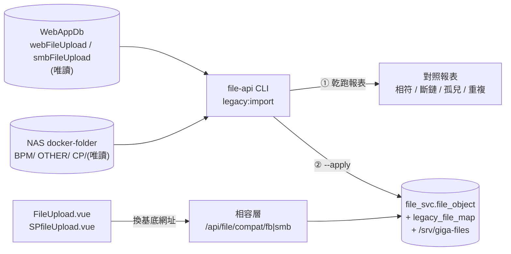

# GigaNexus 附件服務 — filebackend / SMBbackend 接手計畫(F4 + F7)

> 2026-10-13 起草。範圍只含 GeneralBackend 的 **filebackend(:5124)** 與 **SMBbackend(:5125)**;166 PortalSolar 同步(MIGRATION §3)另案,不在本計畫。
> 依據:[MIGRATION.md](MIGRATION.md) §2(NAS 拉取)、[API.md](API.md) §4(相容層規則 1–12)、[LEGACY-INVENTORY.md](LEGACY-INVENTORY.md) §1、§2、§4、§6.1、[DATABASE.md](DATABASE.md) §3。
> 舊服務程式碼、`WebAppDb` 舊資料表、NAS 舊目錄**一律唯讀、不修改**(D9)。時程以甘特圖 W11-7、W11-8 為準。

---

## 1. 目標

BPM 表單的兩支前端元件把基底網址換成相容層之後,可以照常查詢、上傳、下載、刪除。歷史檔案已經搬進新服務並逐筆驗證,舊服務停止收檔、保留唯讀。

| 舊服務 | 前端(`BPM/bpmcomonent`) | 前端路由 | 用到的 API |
| --- | --- | --- | --- |
| filebackend | `FileUpload.vue`(`API_BASE_URL = http://10.10.130.122:5124`) | `FileUpload/:sourceApplication/:sourceNumber/:userNumber/:platform/:role/:class/:filter` | `/sql-files`、`/sql-upload`、`/sql-upload-multiple`、`/sql-download/:id`、`/sql-delete/:id` |
| SMBbackend | `SPfileUpload.vue`(`API_HOST = 10.10.130.122:5125`) | `SPfileUpload/:formid/:userid/:role` | `/api/db/upload`、`/api/db/search?sourceNumber=&effective=`、`/api/db/delete?path=`、`/api/download?path=` |

- `SPfileUpload.vue` 的「無效檔案記錄」按鈕已註解,畫面只查 `effective=true`。
- 兩支元件都沒有 Gateway 登入,身分只靠網址參數的工號(現況)。

## 2. 整體流程

## 3. 批次

| 批次 | 內容 | 前置 | 交付給你測什麼 |
| --- | --- | --- | --- |
| **A1** 匯入工具 | `npm run legacy:import -- --source fb\|smb [--apply]`:讀舊表 + NAS → 乾跑報表;`--apply` 才複製檔案並寫 `file_object` / `legacy_file_map`;可重跑(已匯入的 `legacy_key` 跳過);`--since` 做切換前差異同步 | 無(先以 `giganexus_gw_poc_test` 假資料表與暫存目錄測) | 單元 / 整合測試結果 |
| **A2** 相容層 | `src/routes/compat-fb.ts`(7 支)、`compat-smb.ts`(6 支),舊式 JSON 與錯誤格式(規則 1–12);以舊 controller 的回應當 golden 樣本比對欄位 | 無 | 單元測試、舊前端在本機對測(批次 C) |
| **A3** 部署設定 | Compose 唯讀掛載 `/mnt/nas-docker/{BPM,OTHER,CP}`(主機 2 已掛 `docker-folder`,不需新帳號);`WEBAPPDB_*` 唯讀連線設定與機密腳本 | A1 | — |
| **B** 測試區乾跑與匯入 | 主機 2 跑乾跑 → 報表給你確認 → `--apply` 匯入測試區 → 檔案數 / SHA-256 對照 | **`WebAppDb` 唯讀帳號**(§5 Q3) | 對照報表、檔案管理頁看得到舊檔 |
| **C** 舊前端對測 | 本機跑 `bpmcomonent`(vite 5147),基底網址指向測試區相容層,兩支元件逐項操作 | 相容路由公開方式(§5 Q1、Q2) | 你用 BPM 的畫面實測 |
| **A4** 「舊系統」Tab | GigaItApp 檔案管理加「舊系統」Tab:`legacy_file_map` 唯讀清單(來源、舊 id、原檔名、單號、狀態)、`GET /api/file/legacy/*`(`file.legacy.read`) | A1 | 畫面 |
| **D** 正式切換 | 正式區部署 → 最後一次差異同步 → `bpmcomonent` 換基底網址並上線 → 舊服務停收檔、保留唯讀 | 正式區 file-api(§5 Q4) | — |

A1、A2 不需要等任何人,今天先做;B、C 等 §5 的決定。

### 3.1 進度

| 批次 | 狀態 |
| --- | --- |
| A1 匯入工具 | ✅ 2026-10-13 程式完成(`src/modules/legacy/legacy-import.ts`、`webappdb.ts`、`src/cli/legacy-import.ts`);單元測試以暫存目錄模擬 NAS |
| A2 相容層 | ✅ 2026-10-13 程式完成(`src/compat/`、`src/modules/compat/`;migration `20261013022248_compat`);單元 23 項 + SQL Server 2012 整合 3 項;已經程式碼審查與資安審查並修正(§3.3) |
| A3 部署設定 | ✅ Compose 一次性服務 `legacy-import`(profile,不長駐;只有它唯讀掛 `/mnt/nas-docker` → `/data/legacy` 與 WebAppDb 密碼,報表寫主機 `/srv/giganexus/file-legacy-import`);`deploy/host2-set-legacy-secrets.sh` |
| 使用者 | ⬜ 220 執行 `db/dba/03-create-webappdb-readonly.sql`;主機 2 執行 `host2-set-legacy-secrets.sh`;開發機 `.env` 加 `WEBAPPDB_*` |
| migration 套用到 `giganexus_gw_test` | ⬜ 部署前以 `npm run db:migrate` 套用(共用測試庫,先徵得同意) |
| B、C、A4、D | ⬜ |

### 3.2 批次 C 需要改的其他 repo(跨 repo,動手前再確認)

- **Gateway**(`giga-api-gateway-bff/nginx/conf.d/portal.conf`):新增 `location ^~ /api/file/compat/`(優先於一般 `/api/` 經 BFF 的規則;相容路由不在 BFF 路由表,經 BFF 只會 404):`allow` 122 與開發機 10.10.112.13、`deny all`、`client_max_body_size 31m`、直接 `proxy_pass http://file-api:51272/compat/`(不經 BFF、不做 `auth_request`)、重列 `json-errors` 之外的錯誤頁(相容層錯誤由 file-api 回舊式 JSON);`proxy_set_header X-Forwarded-For $remote_addr`(不可用 `$proxy_add_x_forwarded_for`,否則稽核 IP 可被用戶端偽造)、`limit_req` 限流;在 Gateway `docs/DevelopmentProcess/` 留紀錄。
- **bpmcomonent**(使用者 2026-10-13 同意例外):`default.conf` 加 `location /file-compat/ { proxy_pass https://<gateway>/api/file/compat/; client_max_body_size 31m; proxy_set_header X-Forwarded-For $remote_addr; }`;`FileUpload.vue` 的 `API_BASE_URL`、`SPfileUpload.vue` 的 `API_BASE_URL` 改為 `/file-compat/fb`、`/file-compat/smb`。**正式切換(批次 D)前不部署到 122**;批次 C 只在本機 vite 以 proxy 指向測試區對測。

### 3.3 審查結果(2026-10-13,子代理 code-reviewer / security-auditor)

| 項目 | 處理 |
| --- | --- |
| SMB 時間改 `+08:00` 會讓 `SPfileUpload.vue` 顯示 NaN | ✅ 改回舊格式(台灣時間 + `Z`),加測試照抄舊 `formatDate`(API 規則 15) |
| 新 API 看得到相容層檔案(上傳者工號未驗證,可冒名、可經新 API 改舊附件) | ✅ 新 API 查詢 / 綁定 / 刪除 / 暫存清除加 `compat_ns IS NULL`(規則 17) |
| 長駐 file-api 掛整個 NAS 與 WebAppDb 密碼 | ✅ 改為一次性服務 `legacy-import`(compose profile) |
| SMB 同 path 多筆有效列匯入失敗 | ✅ 只匯入 id 最大的一筆,其餘標 `duplicate-path` |
| 單檔讀取失敗中止整個乾跑、清除失敗被吞掉、commit 失敗留暫存、符號連結 | ✅ `unreadable` 繼續處理;錯誤寫入報表;discard;`lstat` 不跟隨連結 |
| `legacy_meta` 2000 字可能不夠 | ✅ 改 `nvarchar(max)`(migration 重新產生,只套用過整合測試庫) |
| 框架 4xx 被當 500 | ✅ 回舊式 4xx |
| 免 Token 路由的實際暴露面(能連 BPM 前端的人都能列出 / 下載 / 刪除;同 Docker 網路的容器可直連) | ⚠️ 與舊服務現況相同(§5 Q2 已接受);批次 C 再評估是否加 Nginx 共用標頭驗證(縱深防禦) |
| 稽核 IP 可偽造、免驗證上傳無限流 | ⚠️ 批次 C 的 Nginx 設定處理(§3.2) |
| WebAppDb 的 `public` / `guest` 是否有額外權限 | ⚠️ 執行 03 SQL 後請確認 |

## 4. 設計要點

### 4.1 匯入對應(舊表 → 新表)

| 舊欄位 | `file_object` | `legacy_file_map` |
| --- | --- | --- |
| `id` | — | `legacy_key`(字串) |
| `filename`(fb)/ `path`(smb) | — | `legacy_name`;`legacy_dir` = fb 的 `SourcePlatform` 目錄、smb 的子目錄(目前全為空) |
| `originalName` | `original_name` | — |
| `SourcePlatform` | `source_system`(原值,不正規化) | — |
| `SourceApplication` | `source_app`(完整字串,不拆) | — |
| `SourceNumber` | `ref_no`;`bound_at` = 上傳時間(不是暫存檔,不會被 24 小時清除) | — |
| `userNumber` | `uploaded_by` | — |
| `uploadDate`(`DATETIME`,台灣時間) | `created_at`(轉 UTC) | — |
| `Description`、`version`、`userAgent`、`ip` | 新欄位 `legacy_meta`(相容層原樣回傳用) | — |
| — | — | `legacy_source` = `filebackend` / `smbbackend`,`legacy_db` = `WebAppDb`,`legacy_table` = 表名 |

- **新增欄位 `file_object.compat_ns`**(`fb` / `smb` / NULL)、**`compat_key`**(fb = 舊 id 或 UUID、smb = path)、**`legacy_meta`**(上表的舊欄位 JSON):相容層的清單只回自己命名空間的檔案(舊檔 + 經相容層新上傳的檔),不會把新服務的其他檔案列給舊前端。
- 只匯入 `Effective = 1`;`Effective = 0` 只出現在報表(畫面不查無效檔,§1)。
- 實體檔在 NAS 找不到(斷鏈)的有效資料列:**不匯入**,列入報表逐筆處理(MIGRATION §1 第 4 點)。
- 同內容重複上傳(fb 13 組、CP 11 組)各自一筆,不合併。
- 每個檔案複製時算 SHA-256,寫入後再讀一次比對;之後由既有備份排程送到 NAS `giga-files/{env}/`。
- 檔案類型白名單:舊檔**不套用**(歷史檔照收),報表列出白名單外的副檔名。

### 4.2 相容層行為

- 讀寫都走 `file_object`;舊整數 id 經 `legacy_file_map.legacy_key` 轉 UUID,新檔的 `id` 就是 UUID(規則 2)。
- 經相容層上傳:`compat_ns` 設好、`ref_no` = `sourceNumber`、`bound_at` = 現在(不走兩段式);`uploaded_by` = `userNumber`、`company_id` 空白。
- `/sql-files` 不帶 `limit` 時回全部有效檔(上限 1000),修正舊的 50 筆缺陷(規則 8)。
- 資料庫連不上回 503,不退回只存檔(規則 7)。
- 稽核照寫 `file_access_log`,`user_id` = 網址參數的工號(未驗證,欄位標示 `compat`)。

## 5. 決定(使用者 2026-10-13)

| # | 問題 | 決定 |
| --- | --- | --- |
| Q1 | 舊前端怎麼連到相容層 | ✅ **`bpmcomonent` 的 Nginx 反向代理** `/file-compat/` → Gateway:同來源,不必改 Gateway CORS、不受測試區憑證影響;前端改相對路徑。**`bpmcomonent` 例外允許修改**(只限 `default.conf` 代理與兩支元件的基底網址,AGENT §7.1)。PRD §11 #16 的 CORS 因此不需要 |
| Q2 | 相容路由免登入(`auth_mode = public`)+ 只放行內網來源(PRD §11 #15) | ✅ 接受;Gateway Nginx 白名單只放 `bpmcomonent` 所在主機(122),等同現況的暴露程度,新 API 不受影響 |
| Q3 | `WebAppDb` 唯讀帳號(只 SELECT `webFileUpload`、`smbFileUpload`) | ✅ 使用者在 220 自己建(SQL `file-api/db/dba/03-create-webappdb-readonly.sql`,機密腳本 `deploy/host2-set-legacy-secrets.sh`) |
| Q4 | 正式切換時間 | 正式區 file-api 依賴 Gateway 正式區(2026-12);現在做到測試區演練完成,切換跟 12 月正式上線一起 |
| — | 開發分支 | 直接在 `develop`(使用者為 Maintainer,推送即部署測試區) |

## 6. 風險

- 時間:假設 220 的 `GETDATE()` 是台灣時間(舊服務畫面顯示的就是這個值);批次 B 乾跑時以 NAS 檔案修改時間對照 `uploadDate` 確認,不符時調整 `taipeiDate`。
- 舊表 `filesize` 與 NAS 實際大小不同時以 NAS 為準(報表列出 `sizeDb` / `sizeNas`)。

- NAS 是時間點快照:切換前要請 122 再跑一次 robocopy(或凍結舊服務上傳),再用 `--since` 補差異。
- 切換後舊前端的新上傳進新服務,舊服務不再收檔;切換前必須完成並驗證歷史檔匯入(規則 5)。
- 舊整數 id 可被逐號猜測(舊問題),相容層照舊接受;新檔改用 UUID。
